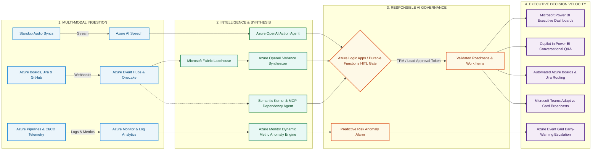

# AI & Workflow Automation – Project Management (Azure Edition)

An enterprise Technical Program Management (TPM) acceleration framework engineered to transform program operations. Built exclusively on Microsoft Azure and Microsoft AI reference architectures, this repository replaces traditional operational overhead—manual status spreadsheets, retrospective meeting notes, and reactive status chasing—with event-driven telemetry, automated executive synthesis, agentic dependency tracking, and predictive risk detection.

Authored by **David Maralack** (PMP, PMI-CPMAI, AWS Certified AI Business Strategist).

---

## 1. Operating Philosophy: Building Systems Instead of Chasing Status

In large-scale engineering organizations, traditional technical program management frequently degenerates into administrative maintenance: compiling weekly status decks, chasing engineers for updates, and capturing fragmented notes during stand-ups. This operating model introduces structural delivery risks:

*   **Reporting Lag:** Static status decks published on Fridays reflect issues that occurred days earlier, rather than surfacing blockers emerging next week.
*   **Engineering Administrative Tax:** Tech leads and engineering managers routinely lose three to five hours every week compiling manual variance summaries.
*   **Siloed Delivery Signals:** Pull-request review latency, work item churn, and cross-team dependencies reside in separate repositories and issue trackers, obscuring critical-path risks until key delivery dates slip.

This repository operationalizes the **PMI-CPMAI (Cognitive Project Management for AI)** methodology and **Microsoft Cloud Adoption Framework for Azure**. It addresses five foundational questions for modern technical program delivery:

1.  **What information should be automated?** Routine operational data collection, stand-up action-item extraction, and backlog status aggregation across Azure Boards and Jira.
2.  **What reporting can be generated instead of manually created?** Executive narrative variance reports, sprint burn-down summaries, and multi-team delivery briefs.
3.  **What signals predict future risk?** Pull-request turnaround delays in Azure Repos/GitHub, cross-repository dependency aging, and anomalous pipeline failure rates.
4.  **What data should be surfaced before executives ask for it?** Critical-path dependency lags, capacity bottlenecks, and trade-off scenarios on scope versus schedule.
5.  **What decisions can be accelerated through AI and analytics?** Resource rebalancing across partner teams, scope descoping decisions, and automated bug triage.

---

## 2. Comparative Operational Model

The following matrix contrasts traditional manual program coordination against the automated, telemetry-driven operating model implemented in this architecture:

| Operational Dimension | Traditional Program Management | Automated AI & Telemetry TPM Operating Model (Azure) | Quantifiable Business Impact |
| :--- | :--- | :--- | :--- |
| **Executive Status Reporting** | Manual status decks compiled every Friday from disparate team leads | Automated serverless data pipeline feeding Azure OpenAI Service for executive variance synthesis | **80% reduction** in status preparation time (from hours to 10 minutes) |
| **Meeting Operations & Follow-ups** | Manual note-taking in open-ended meetings, leading to dropped action items | Azure AI Speech conversation transcription pipeline parsing discussions into structured Azure DevOps/Jira work items | **100% action-item capture** with zero post-meeting administrative lag |
| **Cross-Team Dependency Tracking** | Bi-weekly cross-functional sync meetings with manual dependency logs | Multi-agent backlog discovery using Semantic Kernel, Model Context Protocol (MCP), and Azure Logic Apps HITL gates | Automated detection of unstated API and contract mismatches across repositories |
| **Delivery Risk & Milestone Tracking** | Reactive post-mortems conducted after milestone targets slip | Real-time Azure Monitor Dynamic Thresholds & Log Analytics anomaly detection on PR cycle times and ticket churn | **2 to 3 weeks earlier** risk identification prior to release milestone gates |
| **Data Architecture & Visibility** | Static, disconnected spreadsheets across individual teams | Centralized Microsoft Fabric Lakehouse (OneLake, Data Factory, Power BI) providing single source of truth | Elimination of redundant data reconciliation and subjective reporting |

---

## 3. High-Level Infographic Flow & Architecture

The architecture transforms unstructured operational noise—scattered work items, lengthy stand-up discussions, and disparate commit streams—into verifiable executive decision velocity. It moves operational data through four interconnected stages with strict Human-in-the-Loop (HITL) checkpoints.

### Visual Infographic Architecture (GitHub Rendered)



### Infographic Flow: From Operational Noise to Executive Clarity

```
  ┌────────────────────────────────────────────────────────────────────────────────────────┐
  │                           STAGE 1: MULTI-MODAL INGESTION                               │
  │  Standup Audio ──► Azure AI Speech (Domain Vocabularies & Speaker Diarization)         │
  │  Issue Logs    ──► Azure Event Hubs / OneLake (Real-time Webhook Ingestion)            │
  │  CI/CD Churn   ──► Azure Monitor & Log Analytics (Commit Velocity & PR Cycle Metrics)   │
  └──────────────────────────────────────────┬─────────────────────────────────────────────┘
                                             │
                                             ▼
  ┌────────────────────────────────────────────────────────────────────────────────────────┐
  │                        STAGE 2: AI SYNTHESIS & METRIC MATH                             │
  │  Action Extraction ──► Azure OpenAI Service (Zero-Shot JSON Schema Parsing)            │
  │  Variance Analysis ──► Microsoft Fabric + Azure OpenAI Narrative Synthesizer           │
  │  Dependency Audit  ──► Semantic Kernel + Model Context Protocol (Cross-Repo Backlog)   │
  │  Anomaly Detection ──► Azure Monitor Dynamic Thresholds (Statistical Expected-Bands)    │
  └──────────────────────────────────────────┬─────────────────────────────────────────────┘
                                             │
                                             ▼
  ┌────────────────────────────────────────────────────────────────────────────────────────┐
  │                      STAGE 3: RESPONSIBLE AI GOVERNANCE GATE                           │
  │  Azure Logic Apps & Durable Functions Human-in-the-Loop (HITL) Workflow Execution     │
  │  ├── Programmatic Pause Token: Halts autonomous updates to production roadmaps         │
  │  ├── TPM / Tech Lead Review: 5-minute review of AI-synthesized narrative variance      │
  │  └── One-Click Verification: Approves task dispatch via Teams Adaptive Card callback   │
  └──────────────────────────────────────────┬─────────────────────────────────────────────┘
                                             │
                                             ▼
  ┌────────────────────────────────────────────────────────────────────────────────────────┐
  │                        STAGE 4: EXECUTIVE DECISION VELOCITY                            │
  │  Live Visibility   ──► Microsoft Power BI & Copilot in Power BI (Conversational BI)    │
  │  Delivery Rhythm   ──► Automated Microsoft Teams Synthesis Broadcasts                  │
  │  Action Execution  ──► Direct Azure Boards & Jira Work Item Generation                 │
  │  Proactive Defense ──► 2-to-3 Week Early Warning Event Grid Risk Notifications         │
  └────────────────────────────────────────────────────────────────────────────────────────┘
```

### Stage-by-Stage Operational Walkthrough

| Stage & Component | Primary Azure Services | Operational Input | TPM Output & Business Impact |
| :--- | :--- | :--- | :--- |
| **1. Multi-Modal Ingestion** | Azure AI Speech, Azure Event Hubs, Azure Blob Storage / OneLake, Azure Monitor | Unstructured meeting recordings, Azure Boards/Jira events, CI/CD telemetry | Centralized, query-ready operational data stream without manual reporting sheets |
| **2. Intelligence & Synthesis** | Azure OpenAI Service (GPT-4o), Microsoft Fabric (Data Factory, Synapse), Semantic Kernel | Multi-speaker transcripts, sprint burndown metrics, cross-repo API PRs | Automated JSON action items, cross-team dependency mapping, and 3-bullet variance summaries |
| **3. Responsible AI Governance** | Azure Logic Apps, Azure Durable Functions, Microsoft Teams Adaptive Cards | AI-drafted milestone adjustments, unassigned tasks, narrative summaries | **Zero hallucination risk**; enforces human accountability and audit trails before updating master plans |
| **4. Executive Decision Velocity** | Microsoft Power BI, Copilot in Power BI, Microsoft Teams, Azure Event Grid | Validated executive summaries, anomaly scores, approved work items | **80% reporting time savings**; eliminates surprise slips with 2–3 week predictive warnings |

---

## 4. Implementation Modules

The implementation is partitioned into four modular, production-ready components that directly correspond to enterprise AI competencies:

### Module 1: Meeting & Standup Intelligence (`/01-meeting-intelligence`)
*   **Focus Area:** Automating meeting summaries, action items, and follow-ups.
*   **Azure Reference Lineage:** Adapted from `Azure-Samples/cognitive-services-speech-sdk` and `Azure-Samples/azure-openai-summarization`.
*   **Technical Implementation:**
    *   **Azure AI Speech:** Ingests recorded multi-speaker stand-ups and technical design syncs, applying custom domain vocabularies to handle internal engineering codenames, microservice architectures, and hardware acronyms.
    *   **Azure OpenAI Structured Parsing:** Processes transcripts using high-fidelity prompts to extract clear action items formatted into strict JSON schemas:
        ```json
        {
          "action_items": [
            {
              "task": "Update authentication token validation schema",
              "assignee": "auth-infra-lead",
              "priority": "P1",
              "blocking_dependency": "API-Gateway-v2",
              "target_completion": "2026-11-20"
            }
          ]
        }
        ```
    *   **Automated Work Item Creation:** An Azure Function ingests the validated JSON payload and automatically generates linked Azure Boards or Jira work items with assigned owners and milestone tags.

### Module 2: Automated Executive Reporting & Variance Dashboards (`/02-executive-reporting`)
*   **Focus Area:** AI-driven project tracking, executive reporting, and live dashboard generation.
*   **Azure Reference Lineage:** Adapted from `Azure-Samples/modern-data-warehouse-fabric` and `Azure-Samples/powerbi-copilot-samples`.
*   **Technical Implementation:**
    *   **Telemetry Aggregation (Microsoft Fabric & Azure Synapse Analytics):** Queries historical sprint velocity, pull-request turnaround times in Azure Repos/GitHub, and open bug severity distributions across multiple team backlogs.
    *   **Narrative Synthesis (Azure OpenAI Service & Microsoft Copilot Studio):** Generates structured, three-tiered executive briefing summaries:
        *   *Milestones Delivered:* Quantifiable sprint achievements tied directly to quarterly objectives.
        *   *Variance & Root Cause:* Objective breakdown of slipped tasks, separating vendor delays from technical discovery debt.
        *   *Strategic Decisions Required:* Actionable trade-offs presented to leadership regarding scope adjustments, resource reallocations, or accepted technical debt.
    *   **Executive Visualization (Microsoft Power BI):** Connects to the underlying OneLake Lakehouse to present real-time burndowns and risk distributions powered by Copilot in Power BI, eliminating the need for manually formatted static status presentations.

### Module 3: Agentic Dependency Orchestration & Tool Governance (`/03-agentic-orchestration`)
*   **Focus Area:** Hands-on AI tool utilization and building AI-powered workflows with verified controls.
*   **Azure Reference Lineage:** Adapted from `Azure-Samples/semantic-kernel-samples` and `microsoft/autogen`.
*   **Technical Implementation:**
    *   **Azure AI Foundry & Semantic Kernel / AutoGen:** Configures autonomous agents equipped with OpenAPI plugins to query disparate team repositories (e.g., client application repos versus core cloud infrastructure repos).
    *   **Model Context Protocol (MCP) & GitHub Copilot:** Connects language model reasoning to external developer tooling, cross-referencing API contract pull requests in Azure Repos/GitHub against delivery roadmap commitments.
    *   **Durable Functions / Logic Apps Human-in-the-Loop (HITL) Gate:** Ensures that autonomous agents cannot unilaterally alter production roadmap baselines. When an agent identifies a potential dependency clash, it drafts a mitigation proposal and halts execution until an authorized TPM reviews and approves the change via interactive Microsoft Teams Adaptive Cards.

### Module 4: Predictive Delivery Risk & Telemetry (`/04-predictive-risk-telemetry`)
*   **Focus Area:** Using predictive analytics and telemetry to identify delivery risks and blockers prior to milestone impact.
*   **Azure Reference Lineage:** Adapted from `Azure-Samples/azure-monitor-alert-samples` and `Azure-Samples/cognitive-services-metrics-advisor`.
*   **Technical Implementation:**
    *   **Dynamic Anomaly Detection:** Configures Azure Monitor Dynamic Threshold algorithms and Kusto Query Language (KQL) routines over engineering telemetry, establishing dynamic expected-value bands for pull-request review turnaround, ticket re-opening rates, and unassigned blocker aging.
    *   **Adaptive Data Monitoring Framework:** Builds on telemetry monitoring principles and patented techniques (U.S. Patent #8,984,124: *System and Method for Adaptive Data Monitoring*) to filter noise and flag statistically meaningful delivery deceleration.
    *   **Proactive Warning Alerts:** Automatically notifies TPMs and engineering directors two to three weeks before scheduled release dates via Azure Event Grid and Microsoft Teams when upstream dependency churn indicates a high probability of delivery slip.

---

## 5. Repository Structure

```
ai-workflow-automation-pm-azure/
│
├── README.md                                  # Executive summary, operating model & architecture
├── LICENSE                                    # MIT License
│
├── 01-meeting-intelligence/
│   ├── function_speech_transcribe_trigger.py  # Serverless audio ingestion and transcription trigger
│   ├── prompts/action_item_extractor.json     # Azure OpenAI prompt template enforcing strict JSON output
│   └── tests/test_speech_pipeline.py          # Unit tests for domain vocabulary and extraction
│
├── 02-executive-reporting/
│   ├── fabric_pipeline_sprint_metrics.py      # Microsoft Fabric / Data Factory ETL aggregating metrics
│   ├── azure_openai_variance_summarizer.py    # Multi-tier executive narrative generation script
│   └── powerbi_report_definition.pbit         # Power BI dashboard dataset and schema mapping
│
├── 03-agentic-orchestration/
│   ├── semantic_kernel_pm_plugins.json        # Semantic Kernel plugin definition for PM tools
│   ├── durable_functions_hitl_workflow.py     # Durable Functions state workflow with approval gates
│   └── mcp_azure_devops_connector.py          # Model Context Protocol Azure DevOps connector
│
└── 04-predictive-risk-telemetry/
    ├── kql_delivery_anomaly_queries.kql       # Kusto Query Language (KQL) delivery anomaly queries
    └── risk_scoring_pipeline.py               # CPMAI predictive risk scoring and notification logic
```

---

## 6. Technology Stack & Frameworks

*   **Cloud Infrastructure & Enterprise Serverless:** Microsoft Azure — Azure OpenAI Service, Azure Functions, Azure Logic Apps, Azure Durable Functions, Azure AI Speech, Azure Monitor, Log Analytics, Microsoft Fabric, OneLake, Azure Data Factory, Azure Synapse Analytics, Azure Event Hubs, Azure Event Grid, Azure Communication Services.
*   **Generative AI & Enterprise Assistants:** Azure OpenAI Service (GPT-4o, GPT-4o-mini), Microsoft Copilot Studio, Copilot in Power BI, GitHub Copilot, Semantic Kernel, AutoGen, Model Context Protocol (MCP).
*   **CI/CD & Delivery Systems:** Azure DevOps (Azure Boards, Azure Repos, Azure Pipelines, Azure Artifacts), GitHub Enterprise, GitHub Actions, Microsoft Teams, Jira Software.
*   **Business Intelligence & Telemetry:** Microsoft Power BI, Copilot in Power BI, Azure Monitor Dynamic Thresholds, Kusto Query Language (KQL).
*   **Governance & Program Frameworks:** Project Management Professional (PMP)®, PMI Certified Professional in Managing AI (PMI-CPMAI), Microsoft Cloud Adoption Framework for Azure, Azure Well-Architected Framework.

---

## 7. Professional Background & Attribution

**David Maralack**  
*Senior Technical Program Manager & Enterprise AI Specialist*  
Seattle, WA | [LinkedIn Profile](https://linkedin.com/in/david-maralack-3898135) | [GitHub Profile](https://github.com/maralackdavid)

*   **Enterprise Track Record:** Over two decades of proven leadership orchestrating large-scale software and hardware platforms at **Microsoft** (12+ years across Windows, Bing, Anti-Piracy Licensing Telemetry) and **Amazon** (Kindle, Alexa, Customer Support Operations).
*   **Intellectual Property:** Co-inventor, **U.S. Patent #8,984,124** (*System and Method for Adaptive Data Monitoring*, assigned to Microsoft) and **U.S. Patent #8,683,579** (*Software Activation Using Digital Licenses*, assigned to Microsoft).
*   **Industry Credentials:** Certified Project Management Professional (PMP)®, PMI Certified Professional in Managing AI (PMI-CPMAI), AWS Certified AI Business Strategist.
